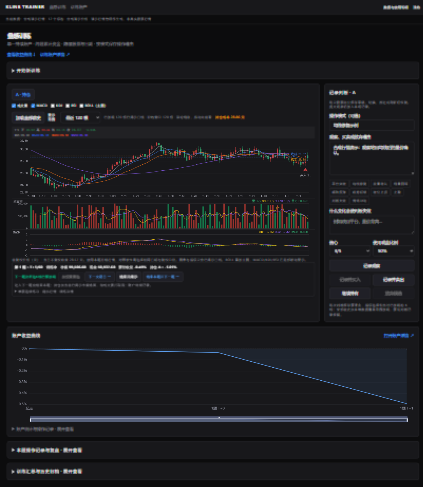

# Kline Trainer · 盘感训练

独立运行的本地盘感训练工具。从历史行情或策略信号中抽题，隐藏股票名称、代码和真实日期，一天一天推进，记录自己的买卖判断。

从 [Tick Stock Panel](https://github.com/shy3130/tick-stock-panel) 提取，使用 **MIT** 许可。只需要 Python 与 Node.js，不需要安装 TSP，也不需要行情 API Key。首次启动会自动生成可练习的合成演示行情。



## 可以做什么

- **匿名训练**：单票连续练习、多票比较；随机行情、突破、新高/新低、量价与趋势等训练类型；导入策略信号后以信号日作为 T+0。
- **完整图表**：120 / 250 / 500 根或全部前史；MA、成交量、MACD、KDJ、RSI、BOLL；最新价虚线和持仓成本线。
- **操作记录**：每只候选独立保存理由草稿、失效条件、标签、信心和操作模式，切换股票不串记录。
- **持续账户**：跨题延续资金，底部收益曲线；账户详情、按策略归档、JSON 导出；点击“结束记录”才关闭账户。
- **训练揭示**：结束后显示真实标的、从 T+0 到预设末日的最大涨跌幅和最终结果；可以重训，已看结果的尝试会单独标记。
- **快速推进**：下一题后台预加载、行情按列读取、日推进增量响应，服务端保存未来行情，仅下发截至当前训练日的数据。
- **可选 AI 复盘**：默认不联网。配置自己的兼容接口后，主动点击分析可总结判断与执行习惯。

## 启动

运行需要 Python **3.11+**。从源码构建前端还需要 Node.js **20.19+ 或 22.12+** 和 npm；下面的 Windows 资源包已构建前端，无需 Node.js。

### Windows 资源包

下载 [Windows 资源包](https://github.com/Yann215/kline-trainer/releases/latest/download/kline-trainer-windows.zip) 并完整解压到固定目录，双击其中的 `windows-start.cmd`。资源包已包含构建好的前端，运行时不需要 Node.js；首次启动需要已安装 Python 3.11+，并联网安装 Python 依赖，之后双击同一文件即可打开应用窗口。默认使用自动生成的合成演示行情。训练记录保存在解压目录的 `runtime/`，升级前请备份该目录；不要把 `.venv` 从一台电脑复制到另一台电脑。

维护者可在构建前端后运行 `python scripts/build_windows_bundle.py` 生成资源包。包中不包含本地虚拟环境、行情、账户记录或密钥。

```powershell
git clone https://github.com/Yann215/kline-trainer.git
cd kline-trainer
.\start.ps1
```

浏览器打开 **http://127.0.0.1:8765**。脚本会创建独立虚拟环境、安装依赖并构建前端；使用 `-Port 8766` 可指定其他端口。首次安装需联网，之后运行训练本身无需联网。

手动安装（Windows / macOS / Linux）：

```bash
python -m venv backend/.venv
# macOS/Linux:
source backend/.venv/bin/activate
# Windows PowerShell: .\backend\.venv\Scripts\Activate.ps1
python -m pip install -c backend/constraints.txt -e './backend[dev]'
cd frontend
npm ci
npm run build
cd ..
python run.py
```

完成安装后再次运行只需 `python run.py`（使用对应虚拟环境）。开发前端时，后端照常启动，另在 `frontend` 运行 `npm run dev`，访问 http://127.0.0.1:5173。

Docker（默认仅本机访问）：

```bash
docker compose up --build -d
```

Docker 将行情和记录保存到 `trainer-data` 卷。不要使用删除数据卷的命令，除非确实要清空自己的训练记录。

## 数据同步

在程序顶部点击 **数据同步**，填写本机 TSP 的 `data` 目录并点击“开始同步”。同步读取本机已经发布的 TSP 股票日线，生成独立的前复权训练数据版本，不会联网更新 TSP；需要最新行情时，请先在 TSP 中更新数据，再回来同步。全市场导入需要较多时间和磁盘空间；开始前至少预留 8 GiB，实际需要量取决于数据规模，旧版本与训练账户会保留。

同步完成后必须重启训练后台服务才能启用新版本，仅关闭窗口不会停止后台；重启电脑后再次打开即可。页面会显示当前使用的数据范围。同步目录只保存在本机运行数据中，不会上传。

## 使用自己的行情与策略

软件代码开源，真实行情不随仓库分发。数据可以是 CSV 或 Parquet：

```bash
kline-trainer import-csv bars.csv --signals signals.csv
```

`bars.csv` 必填字段：

| 字段 | 含义 |
| --- | --- |
| symbol | 六位代码与市场后缀，例如 `600001.SH` / `000001.SZ` / `920001.BJ` |
| date | 已结束交易日，`YYYY-MM-DD` |
| open, high, low, close | 前复权价格，元；需要使用一致的复权基准 |
| raw_close, raw_high, raw_low | 当日不复权原价，用于涨跌停和除权衔接，不能直接从前复权价猜测 |
| volume | 成交量，**手**（100股），不能混入股数或成交额 |

可选字段：`name`、`consecutive_limit_ups`、`consecutive_limit_downs`。无历史涨跌停计数时，对应训练类型自动隐藏。ST 名称采用导入名称，不能保证历史更名已还原。每个题目至少需要120根观察日线及预设长度的后续行情。

`signals.csv` 必填 `date,symbol,strategy_id`。信号必须有对应行情。策略ID只接受字母、数字、下划线和短横线。可以导入多个策略，抽题取候选并集。**外部信号是否使用了未来信息，需由生成信号的一方验证**；本工具不执行任意策略 Python 文件。

未提供信号文件时，导入过程使用只依赖当时历史的三个示例选股条件生成信号：20日放量突破、站回MA5、均线多头。这些只是出题器，不是收益验证过的交易策略。

导入本地 TSP 数据（只读原目录，不复制账户、配置或策略源码）：

```bash
kline-trainer import-tsp --source /path/to/tsp/data --strategy your_strategy_id --max-symbols 100
```

可重复传 `--strategy`；默认最多取100只信号股票，按代码排序，可显式调整上限。优先使用TSP已生成的股票历史投影，否则读取正式 `kline_daily_enriched`。导入保存的是历史信号记录，未重新执行或验证原策略。导入后**重启独立服务**启用新数据。原训练记录仍保留，数据版本不同的旧题目不能混入新历史继续扩展前史；已冻结的题目可继续推进与回顾。

详细数据约定见 [docs/data.md](docs/data.md)。

## 保存位置与账户口径

默认数据目录是项目根目录下的 `runtime/`，在Git中已忽略。行情按不可变版本保存，账户与训练快照保存在 `user_data/training/sessions.sqlite3`。备份整个数据目录即可备份训练；原TSP记录不会自动迁移。

在根目录复制 `.env.example` 为 `.env`，可设置 `TRAINER_DATA_DIR`。设置后重启服务。不要将该目录或 `.env` 提交到 Git。

训练固定初始资金10万元、最多持有一只、100股整手、T+1；佣金双边0.02%、卖出税费0.05%、滑点双边5bp。支持看完当日K线的收盘模拟和次日开盘模式。日线只能模拟约束，无法重建排队、盘中撤单和真实成交；成本不是按历史税率逐日还原。

结束本题时，未平仓部分**按市值结算**后延续到下一题，不算主动卖出，不计入平仓胜率；不是必须平仓才可换题。除权按冻结前复权权益衔接，分红现金到账与配股认购没有单独还原。重训标记为“已看结果”，不得当作首次盲测成绩。

## 可选 AI 复盘

`.env` 中填写 `TRAINER_AI_API_KEY`、`TRAINER_AI_MODEL`，可选 `TRAINER_AI_BASE_URL`（兼容 `/chat/completions`，带 `/v1`）。密钥仅在后端使用。

**只有主动点击“AI总结本场判断”才发送请求**，内容包括最近最多20条操作理由、标签、当时匿名图表摘要和交易统计。真实股票名称、代码、真实日期和未揭示未来K线不进入该复盘证据。自由填写的理由中若包含个人信息，仍会随理由发送；请按自己选择的服务商隐私条款使用。未配置时，统计、导出与训练照常可用。

## 验证与贡献

```bash
cd backend
python -m pytest -q
ruff check app tests
cd ../frontend
npm test
npm run build
```

测试覆盖匿名与时间截止、T+1/费用、订单幂等、逐票记录、持续账户结算、重训、预加载隔离及行情导入失败路径。新增功能请附带相关验证，详见 [CONTRIBUTING.md](CONTRIBUTING.md)。

项目结构：

```text
backend/app/services/   训练、账户、异步预加载
backend/app/dataset.py  版本化行情、列投影与信号数据契约
backend/app/cli.py      启动和CSV/Parquet/TSP导入
frontend/src/custom/   训练页面与账户详情
frontend/src/lib/      API、图表及训练状态工具
```

来源、提取范围及版权说明见 [NOTICE.md](NOTICE.md)，完整许可见 [LICENSE](LICENSE)。
